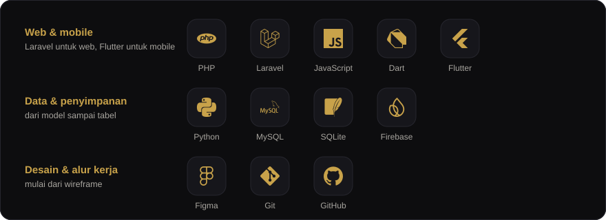

Software engineer lulusan Ilmu Komputer yang membangun web dengan Laravel dan aplikasi mobile dengan Flutter. Proyek terbaru saya, **LingoJoy**, adalah aplikasi latihan pelafalan yang model speech recognition-nya berjalan offline di ponsel.

Terbuka untuk peran software engineer entry-level.

 

## Teknologi

 

## Kontak

&nbsp;

<!-- Aktifkan setelah portfolio di-host, ganti URL-nya:
&nbsp;

-->
