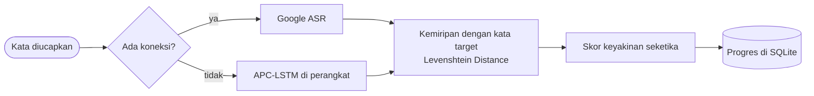

> Saya lebih suka fitur yang benar-benar dipakai orang daripada fitur yang hanya jalan di laptop saya.

Lulusan Ilmu Komputer yang mengerjakan web dengan Laravel dan mobile dengan Flutter, dengan minat ke arah machine learning. Karya terbaru saya, LingoJoy, adalah aplikasi latihan pelafalan yang model suaranya berjalan langsung di ponsel, tanpa internet.

 

## Sekilas

<table>
  <tr><td><b>Berbasis di</b></td><td>Kabupaten Bogor, Jawa Barat</td></tr>
  <tr><td><b>Pendidikan</b></td><td>S1 Ilmu Komputer, Universitas Pakuan (2022 sampai 2026, IPK 3.46)</td></tr>
  <tr><td><b>Pengalaman</b></td><td>Magang sebagai Full-Stack Developer di PT Media Televisi Indonesia (Metro TV), Agustus sampai Oktober 2025</td></tr>
  <tr><td><b>Minat</b></td><td>Pengembangan perangkat lunak, analisis data, dan machine learning</td></tr>
  <tr><td><b>Cara kerja</b></td><td>Merancang antarmuka di Figma lebih dulu, baru menulis kode</td></tr>
  <tr><td><b>Di luar kode</b></td><td>Volunteer divisi keamanan di Festival MIPA 2024</td></tr>
  <tr><td><b>Terbuka untuk</b></td><td>Peran software engineer entry-level</td></tr>
</table>

 

## Alat yang saya pakai

Di luar daftar itu: speech recognition (Google ASR dan APC-LSTM), analisis dan visualisasi data, serta web scraping.

 

## Proyek

<table>
  <tr>
    <td width="33%" valign="top">
      <b>LingoJoy</b> 
      Skripsi, 2026  
      Aplikasi latihan pelafalan yang tetap bisa menilai suara tanpa internet. Google ASR saat online, model APC-LSTM di perangkat saat offline.  
      <code>Flutter</code> <code>Python</code> <code>APC-LSTM</code> <code>SQLite</code>  
      <a href="https://github.com/Praseptya/LingoJoy">Kode sumber</a>
    </td>
    <td width="33%" valign="top">
      <b>Program Budgeting System</b> 
      Magang di Metro TV, 2025  
      Mengganti pengajuan anggaran produksi televisi yang manual dengan entri terstruktur, pelacakan biaya, dan persetujuan bertingkat.  
      <code>Laravel</code> <code>MySQL</code> <code>Figma</code>  
      <a href="https://github.com/Praseptya/Program-Budgeting-System">Kode sumber</a>
    </td>
    <td width="33%" valign="top">
      <b>Discorso</b> 
      Proyek akhir mata kuliah, tim 4 orang, 2025  
      Aplikasi media sosial minimalis dengan feed, like, komentar, dark mode, serta fitur blokir dan laporkan pengguna.  
      <code>Flutter</code> <code>Firebase</code> <code>Figma</code>  
      <a href="https://github.com/Praseptya/Discorso">Kode sumber</a>
    </td>
  </tr>
</table>

<b>Bagaimana LingoJoy menilai pelafalan?</b>

 

Dua jalur pengenalan suara menghasilkan teks yang sama-sama dibandingkan dengan kata target, jadi pengguna mendapat umpan balik yang konsisten, online maupun offline.

Proyek lainnya ada di [daftar repositori saya](https://github.com/Praseptya?tab=repositories).

 

## Hubungi saya

&nbsp;

<!-- Aktifkan setelah portfolio di-host, ganti URL-nya:
&nbsp;

-->
